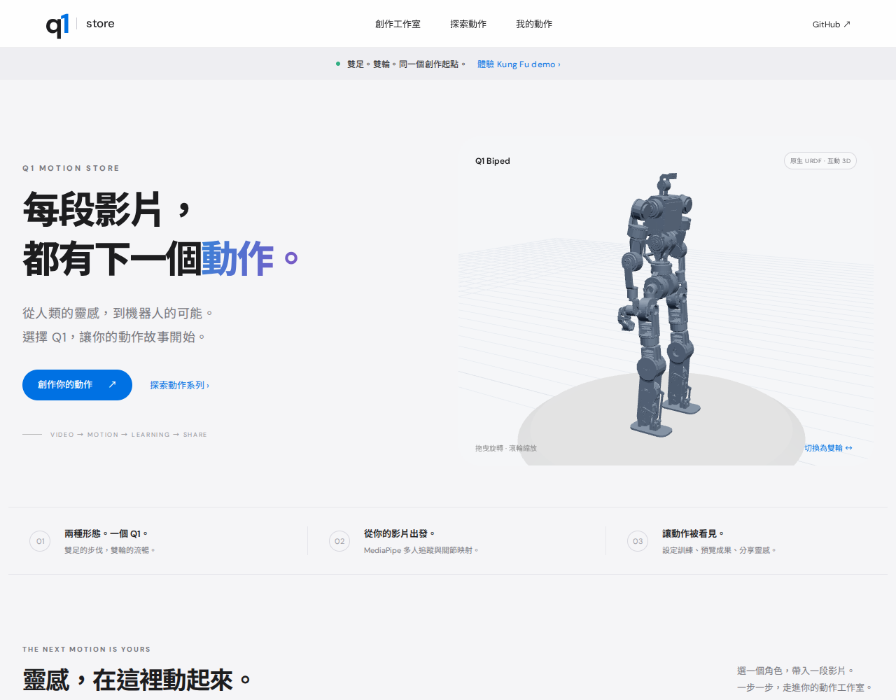
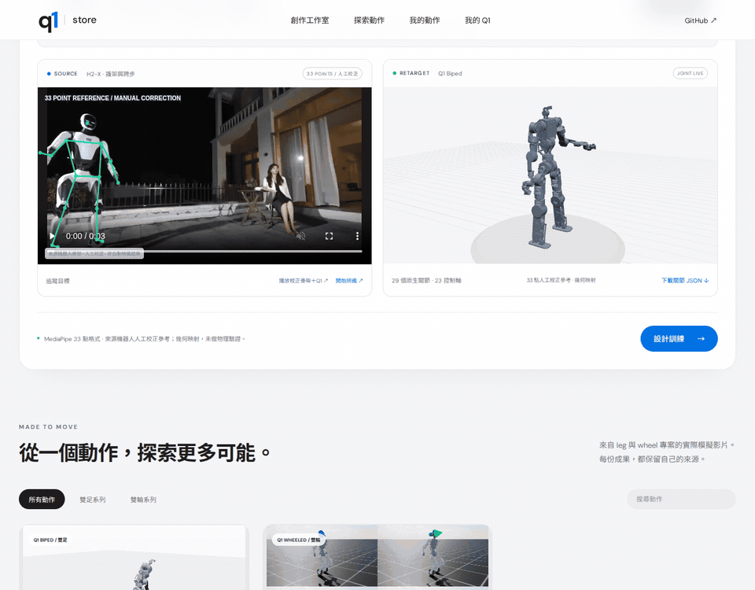
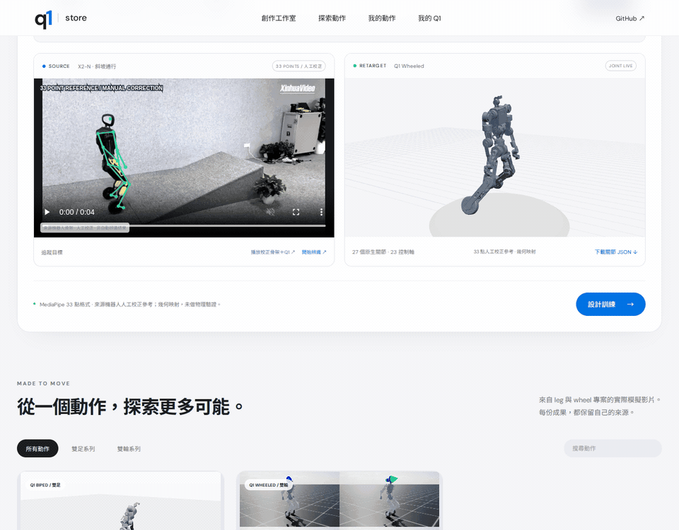
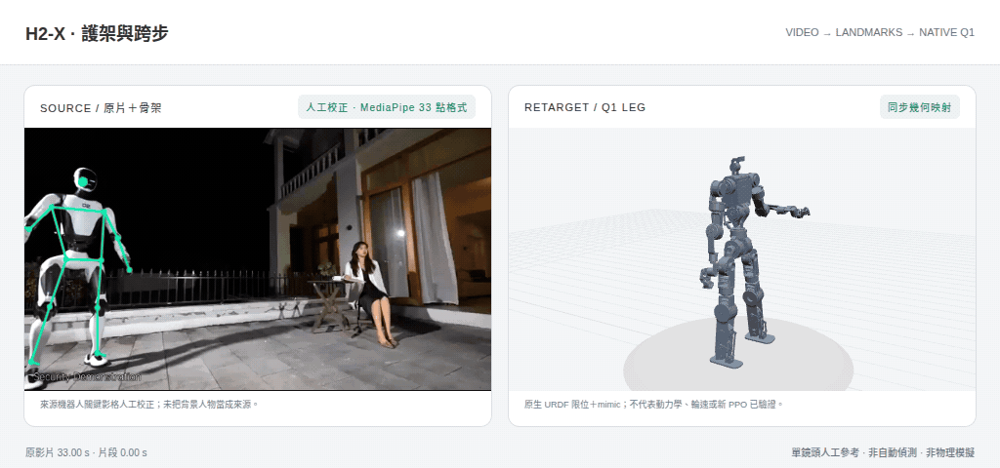
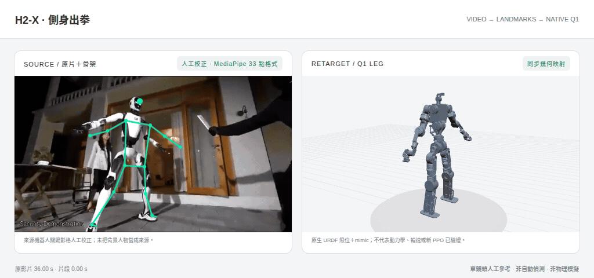
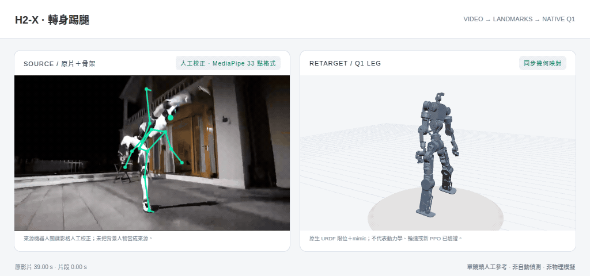
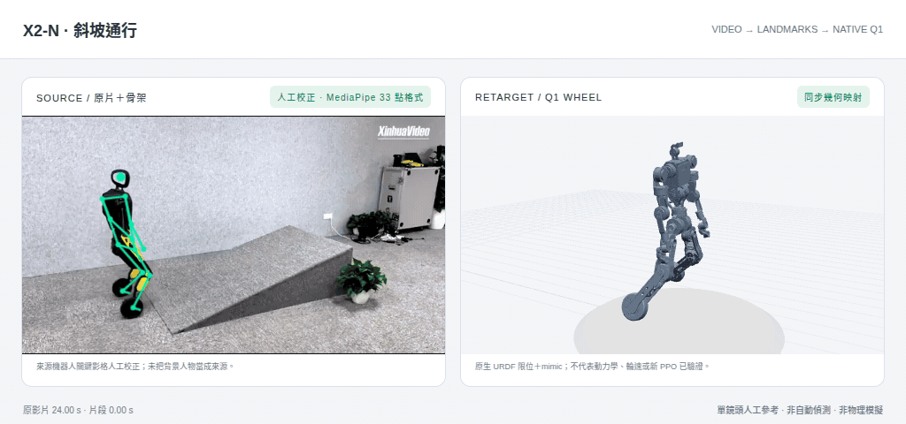
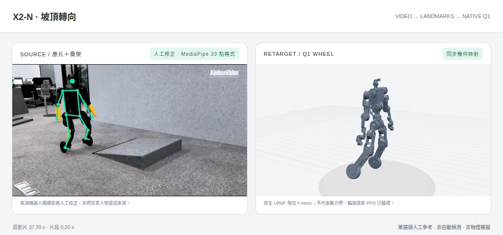

# Q1 Store · 影片到動作的創作工作室

Q1 Store is an interactive concept demo for native Q1 biped and wheeled URDFs:
video pose tracking, geometric retargeting, training plans and a simulated motion
marketplace. It does not train a new PPO policy or charge payments.

沿用 [Q1 Leg](https://github.com/willnien10005914/q1_leg_urdf) 的 store 視覺，
整合 [Q1 Wheel](https://github.com/willnien10005914/q1_wheel_urdf)，在同一個工作室
選擇雙足／雙輪、影片、人物目標、RL／物理／reward、訓練時數與世界地標。



## 指定影片：分段建立 Q1 Leg／Wheel 動作

雙足使用 [Unitree H2-X 功夫影片](https://youtu.be/Y3zb4o47yqA)，雙輪使用
[AgiBot X2-N 影片](https://youtu.be/TV6ctYnA9Io)。工作室已附下列五個靜音短片，
可直接播放、調整起訖、命名並建立各自的訓練工作，不必重新下載 YouTube。
原影片展示的是 H2-X／X2-N；以下短片與 GIF 是**來源參考**，不是 Q1 新訓練的成果。

**Q1 Leg 操作：已載入模型 → 骨架與 Q1 同步映射 → 分段／命名 → 訓練示範 → Deploy 下載。**



**Q1 Wheel 操作：已載入模型 → 骨架與 Q1 同步映射 → 切分輪式動作 → Deploy 下載。**



兩份操作動畫都在模型與影片載入完成後才開始取幀，第一幀直接呈現骨架與原生 Q1。

| 目標機型與動作 | 骨架 GIF 的原片時間／短片時間 | 來源骨架＋Q1 retargeting GIF |
| --- | --- | --- |
| Leg · 護架與跨步 | 00:33–00:35.96／0–2.96 s |  |
| Leg · 側身出拳 | 00:36–00:38.96／0–2.96 s |  |
| Leg · 轉身踢腿 | 00:39–00:40.92／0–1.92 s |  |
| Wheel · 斜坡通行 | 00:24–00:27.96／0–3.96 s |  |
| Wheel · 坡頂轉向 | 00:37.2–00:39.88／0.2–2.88 s |  |

表中動畫同步呈現來源影片、MediaPipe 33 點格式骨架與 Q1 關節映射。
為避免追到背景人物，這批示範參考含人工校正，畫面與資料保留其來源標示；
它們是幾何 retargeting 參考，並非自動辨識已驗收或新 PPO 的物理結果。
骨架參考會避開不連續鏡頭，時間範圍可能短於附帶的原始短片；以 catalog 的 `reference_segment` 為準。

片段欄位以**目前短片的相對秒數**為基準；畫面與工作 JSON 同時保存原 YouTube 的
絕對時間。例如 `h2x-guard` 再選 `0.4–2.6 s`，對應原片 `33.4–35.6 s`。
同一來源可加入多個命名動作；草稿保存片段與名稱，各工作可另外選擇 reward、引擎與時數。

MediaPipe Pose 是人體姿態模型；H2-X 實測曾偵測到背景人物，候選數不代表辨識到機器人。
對這兩支機器人來源，介面先顯示**候選並暫停影片**，不會自動選取；只有使用者核對來源機器人後
明確選取，才開始輸出關節。若只有背景人物，請留空並保存**待提取參考動作的訓練計畫**，
交由機器人專用 tracker 或人工標記補足。Wheel 另需輪速、車身運動與接觸 reference。

目前可播放校正骨架並同步映射到 Q1，也可分段與建立訓練規劃；
**全自動機器人影片 → Q1 PPO 尚未實作，也沒有產生新權重**。
不會以背景人物或程序化骨架冒充來源機器人的 retargeting。

完整步驟、時間欄位與重新產生剪輯的指令見
[影片分段訓練教學](docs/VIDEO_TRAINING_EXAMPLES.md)。
[原程序化骨架操作 GIF](docs/images/kungfu-workflow.gif) 仍保留作離線多人選取練習。

[實際驗證紀錄](docs/VALIDATION.md) · [工作室截圖](docs/images/store-studio.png) · [成果頁截圖](docs/images/store-result.png)

## 現在能做什麼

| 功能 | 狀態與實際行為 |
| --- | --- |
| 雙足／雙輪原生 URDF | 可操作。載入各自 CAD meshes、關節名稱、限位與 mimic。可拖曳旋轉。 |
| 指定影片／分段動作 | 可操作。H2-X → Leg、X2-N → Wheel 共五個真實來源短片；可設定起訖、命名、保存多個動作片段及建立獨立工作。 |
| 校正骨架＋Q1 同步播放 | 可操作。播放已附的人工校正 MediaPipe 33 點格式參考，同步更新來源骨架與原生 Q1 關節；可匯出 motion，仍需物理驗證。 |
| 程序化骨架示範 | 保留為離線多人選取與映射練習；不是指定影片的辨識結果，也不是新 PPO。 |
| 使用者影片 | 可操作。MP4／WebM／MOV 等瀏覽器可解碼影片，MediaPipe 在瀏覽器辨識最多 4 位人物；依顏色選取目標。 |
| 人體影片 retargeting | 可操作。人物姿態映射到所選原生關節，限制角度並匯出 JSON；是幾何參考，未做逆動力學、接觸或平衡驗收。機器人影片需先核對及明確選取候選。 |
| YouTube | 可嵌入預覽。本機選裝 yt-dlp 可取得影片後辨識；iframe 本身不能提供跨來源影格。受限影片下載失敗會明示，不以範例替代辨識。 |
| RL／physics／rewards／時數 | 可選擇並保存工作規劃；Q1 的 Isaac Lab 3 task adapter 尚未接入。 |
| 地標舞台 | 可選台北 101、艾菲爾鐵塔、時代廣場、澀谷、萬里長城。3D 畫面是概念輪廓；尚無地標 USD／RTX 實錄。 |
| 30 秒 demo 流程 | 可操作。展示 retargeting → 訓練示意 → rendering 示意，完成後播放已標示來源的歷史 PPO 影片。 |
| 真實訓練模式 | 建立 `queued_for_worker` 工作。若主機同時執行 `scripts/worker.sh`（需 Isaac Sim／Isaac Lab 與 `~/will/q1_leg_urdf`），雙足工作會真的以 RSL-RL PPO 訓練，進度、ETA、Isaac Lab log、評估與新錄影保存在 `.data/jobs/<id>/`，重啟網站後仍可查看。雙輪 task 尚未接入，會明確標示失敗原因。 |
| SPEC 比較 | 首頁 Motion Studio 之前列出雙足／雙輪的機構、控制與動作支援矩陣，資料來源標示為 source／command／measured／simulated／unmeasured；電池續航未量測時不給數字。 |
| 註冊 Q1／Deploy | 完成 demo 後可註冊名稱、機型與序號，選擇相符的 Q1，下載目標機器人的部署預覽套件。現階段不含新 policy 權重，不會傳送控制命令或宣稱機器人已接收。 |
| 分享／價格／收藏／購買 | 可操作的模擬市集。保存分享記錄與零收款收據；沒有真實付款或交付新權重。 |

**這次輸入的功夫／使用者影片不會在 30 秒內訓練成 PPO。** 示範成果也不是
所選地標的 Isaac Sim 新錄影。真正 worker 需要的銜接列於
[Isaac Lab 3 worker 設計](docs/ISAACLAB3_WORKER.md)。

## 本機啟動

需要 **Python 3.11+** 與支援 WebGL 的現代瀏覽器。基本網站／SQLite API 只用標準函式庫，
不需要安裝 Isaac Sim、CUDA 或 Python ML 套件。

```bash
git clone git@github.com:willnien10005914/q1_store_urdf.git
cd q1_store_urdf
bash scripts/start_store.sh --port 8876
# 或：python3 server.py --port 8876
```

開啟 **http://127.0.0.1:8876/**；同網段也可開 `http://<這台 Spark 的區網 IP>:8876/`。
服務預設綁 `0.0.0.0`（區網可連）；若只要本機可改 `--host 127.0.0.1`。
啟動腳本只執行網站服務，不啟動 GPU 訓練。
上傳影片、動作參考與工作／市集記錄保存在忽略追蹤的 `.data/`，
可用 `--data-dir /your/path` 或 `Q1_STORE_DATA` 指定其他位置。

第一次執行真實影片辨識需要網路下載 MediaPipe WASM 與 Pose Landmarker 模型；
Three.js、URDFLoader 與機器人 meshes 已包含在 repository。

### 選裝 YouTube 下載

```bash
python3 -m venv .venv
.venv/bin/python -m pip install -r requirements-motion.txt
Q1_YTDLP="$PWD/.venv/bin/yt-dlp" Q1_STORE_PYTHON=.venv/bin/python bash scripts/start_store.sh --port 8876
```

`yt-dlp` 必須在服務的 PATH，可另外設定 `Q1_YTDLP=/absolute/path/to/yt-dlp`。
依來源格式可能需要主機安裝 `ffmpeg`；YouTube extractor 也可能要求可用的 JS runtime。
下載限制、登入／地區與網站變更仍可能造成失敗，此時可上傳有權使用的影片。
YouTube 嵌入播放器只能預覽；要執行 MediaPipe，必須取得可讀影格的實際影片檔。

### 選裝 Spark GPU 訓練 worker

```bash
# 另一個終端（或 tmux）；預設 Q1_LEG_ROOT=$HOME/will/q1_leg_urdf
Q1_WORKER_NUM_ENVS=2048 bash scripts/worker.sh --data-dir .data
```

worker 透過 `q1_leg_urdf/scripts/isaac_env.sh` 找到 Isaac Sim Python，依序處理
`queued_for_worker` 的雙足工作：以 `q1store/reference.py` 把 MediaPipe 關節參考轉成
leg Motion contract，執行 `scripts/train_store_job.py` 的 train（分段 `runner.learn`，
每段寫 `progress.json`／`latest.pt`，可 `--resume`）與 record（評估、rollout、`result.mp4`）。
網站每 3 秒讀取 `/api/jobs/<id>`：ETA、iteration、steps/s、Isaac Lab log 尾端與 worker 心跳。
worker 離線時工作標示為「worker 離線」，重新啟動 worker 會從最後 checkpoint 接續。
`Q1_WORKER_MAX_BUDGET_S` 可限制每個工作的實際訓練秒數（測試用）。

## 影片分段訓練操作

1. 在 Motion Studio 選擇 **雙足 Biped** 或 **雙輪 Wheeled**，開啟 **影片範例**。
2. 選擇 H2-X 的護架／出拳／踢腿，或 X2-N 的斜坡／轉向短片。
   設定短片的起點、終點與**動作名稱**，按 **預覽這一段** 核對；片段長度為 0.5–60 秒。
3. 按 **加入動作清單**，可再切另一段、另取名稱；每個草稿以 **繼續設定** 建立自己的工作。
   草稿存在瀏覽器，不是 PPO 權重。需要實際姿態時，回到影片頁按 **開始辨識**，
   機器人來源不會自動選取候選；確認確實為來源機器人後才選取及輸出關節，再下載 JSON。
   若只有背景人物請保留未選取，建立參考工作；改片段、來源或人物後需重新辨識。
4. 選擇 **RSL-RL、skrl、RL-Games、Stable-Baselines3 或 TorchRL**，以及
   **Isaac Sim PhysX、Newton MuJoCo Warp 或 OV PhysX**。這些是規劃選項，
   實際支援組合需由註冊後的 Q1 task 驗證。
5. 選擇追蹤、位置、平衡、能耗、平滑等 reward。雙足可選足部接觸，雙輪可選輪速追蹤。
   它們是 Q1 任務設計預設，不是 Isaac Lab 所有任務共用的現成 reward 清單。
6. 設定 **1–24 小時**訓練預算、選擇地標，再開始 **30 秒概念 demo**。
   時數是預算設定，不是成果保證；**匯出真實訓練計畫**只建立待 worker 的工作。
7. 完成後觀看對應機型的歷史參考影片、下載工作 JSON、分享至市集並模擬收藏／購買。
8. 按 **Deploy**，註冊或選取相符機型的 Q1，下載部署預覽套件；目前套件不含新 policy，不能啟動實體機器人。
   本機 `.data/` 工作記錄包含片段 ID（`source.id`）、`action_name`、`segment` 與原片絕對時間。
   計畫的 `motion_extraction_ready` 表示是否已有非程序化 capture，不表示人物、機器人映射或物理品質已驗證。

單鏡頭映射沒有真實尺度與完整遮擋資訊；人物交叉、遮擋或離開畫面可能造成追蹤中斷。
此處的色彩是追蹤 ID，不代表衣服辨識。幾何預覽不可直接當作實機控制策略。

## Deploy 到已註冊的 Q1

成果頁完成後可按 **Deploy**，填寫機器人名稱、機型與序號，再選取目標 Q1 下載 ZIP。
本機 API 會核對 Leg／Wheel 與原生 URDF 版本，套件保存目標機器人、工作計畫、關節契約及可用的動作參考。

目前 demo 下載的是 **preview-only 部署預覽套件**：沒有新 policy 權重、禁止啟動硬體，
也不會把瀏覽器下載標示為機器人已接收。真正下載到機器人並執行，仍需接上 Q1 robot agent、
經驗證的 policy 與裝置回報；舊 24 軸 Wheel 策略不會被當成目前 23 軸模型的可執行權重。

## 已有的真實訓練影片

| 機型 | 包含的歷史成果 | 證據與相容性 |
| --- | --- | --- |
| Leg | [原生閃身步 PPO，7.78 秒](assets/examples/leg/sidestep.mp4)；6,144 envs × 8,000 updates，選定 model_7800 | [來源證據](assets/examples/leg/evidence.json)。獨立模擬評估 31/32 回合存活；目前 URDF 雜湊相符，尚未實機驗證。 |
| Wheel | [歷史滑行 PPO，3,800 updates](assets/examples/wheel/skate.mp4) | [來源證據](assets/examples/wheel/evidence.json)。舊版 **24-action／92-observation**，與目前原生 **23-action** wheel 模型**不相容**；保留作歷史商品範例。 |

影片、MediaPipe 關節參考與 PPO 是不同資料。Leg 的
[MediaPipe 參考](assets/examples/leg/sidestep_motion.json) 來源為
[原始示範前 7 秒](https://youtu.be/KKhF516rSyo)，包含 306/306 有效 source frames 與 20 Hz 原生關節映射。
原始人物影片及 MediaPipe 模型未納入 Git；本 store 也未把這段參考宣稱為功夫新策略。

## URDF 來源與同步

| 機型 | 來源 snapshot | 原生 URDF SHA-256 |
| --- | --- | --- |
| Leg | [568b332](https://github.com/willnien10005914/q1_leg_urdf/tree/568b33229e31cc503b6729d1185c625d35a711a4)，`spark/isaaclab3-balance-6144-15000` | `2a9a5fce0cd4cf116ba22fcc5c2dfc90747e16c7c1c1ccd0914beec61ce7b3ac` |
| Wheel | [358c668](https://github.com/willnien10005914/q1_wheel_urdf/tree/358c668e27a790b572fc18ca0bab63ce5f8ad9fa) | `0a6c9219bf0d7ade77c3a52b1d7334232ee5adc23528f8afe86679bfc2e794e9` |

[manifest.json](assets/robots/manifest.json) 是實際檔案的版本依據：記錄 source commit、
URDF／各 STL 雜湊、關節軸向與限位、mimic、控制順序、模型質量與同步時間。
兩機型各 23 個控制軸；Leg 另有 6 個鎖定關節，Wheel 另有 4 個 mimic 關節。
2026-10-25 檢查 GitHub wheel `main` 的 `207d7cb4` 時，其原生 URDF 與 28 個
引用 STL 均與上述 snapshot 相同。Store 保留原始來源 snapshot，不修改 `~/will` 的訓練工作。

```bash
# 預設：只讀取本機來源，更新 store 內的 snapshot。
python3 scripts/sync_robots.py --source-root ~/will

# 明確選用：先更新兩來源各自已設定的 upstream，僅允許乾淨工作樹及 fast-forward。
python3 scripts/sync_robots.py --source-root ~/will --pull
```

`--pull` 跟隨來源 checkout 的 upstream，並非固定 `main`；任一來源含未追蹤或修改檔案就會拒絕。
目前 wheel 來源的本機 checkpoint 不應為了同步而刪除，可改用獨立乾淨 clone。
更新模型後仍需重新驗證 policy 的關節與 observation／action 契約。

[GitHub 同步 workflow 範本](docs/github-workflows/sync-robots.yml) 設計為啟用後每日 **03:23 UTC** 執行，
也可手動指定 `leg_ref`／`wheel_ref`（branch、tag 或 commit）。預設 Leg 使用上述 Spark 分支，
Wheel 使用 `main`。它在 runner 的暫存目錄建立乾淨 sparse checkouts，將當次解析的
**確切 commit 與雜湊**寫入 manifest，只在內容或來源 commit 改變時提交 store 的資產快照。
它不執行來源的 Python 訓練程式，不修改原始專案，也不自動發布新 policy。
目前 GitHub 登入 token 缺少 `workflow` scope，因此 Actions 範本保留在 `docs/github-workflows/`，**尚未啟用每日排程或 GitHub CI**。
要啟用時，使用可管理 workflows 的登入，將兩個 YAML 複製到 `.github/workflows/` 後提交推送。
本機同步指令與本次原生資產 snapshot 均可直接使用。
工作流程執行時需要 repository 的 Actions `contents: write`；branch protection 若禁止 bot 推送，
同步會失敗並保留 log，不會略過保護。只改 `synced_at` 不會產生每日空更新。

詳細資產及授權資訊：[ROBOT_SOURCES.md](docs/ROBOT_SOURCES.md)。

## 靜態展示與檢查

```bash
python3 scripts/build_static.py
python3 -m http.server 8877 --bind 127.0.0.1 --directory dist
# http://127.0.0.1:8877/

python3 -m unittest discover -s tests -v
```

靜態版會清楚顯示 **瀏覽器 Demo**：工作、關節與市集記錄保存在該瀏覽器 localStorage，
本機影片使用 blob URL 預覽，不上傳伺服器，重新整理後需重新選檔；YouTube 只有嵌入預覽。
多人辨識首次仍需載入 MediaPipe 模型，且大量 motion frames 可能受到瀏覽器儲存配額限制。
Python 版使用 SQLite 與實際影片上傳，適合完整本機展示。
`dist/` 僅包含 `public/` 與公開範例／模型，不包含 `.data/`、source checkout 或上傳影片。
前端使用 `/assets/...` 等根路徑，靜態內容應部署在網域根目錄；未設定 GitHub Pages 專案子路徑。

[CI 範本](docs/github-workflows/ci.yml) 啟用後執行標準函式庫 unittest、Node 的瀏覽器模組語法檢查、
URDF／mesh 雜湊檢查與靜態建置。原生關節映射另有 `node tests/test_retarget.mjs`；完整瀏覽器流程可在安裝 Playwright 後執行 `npm run test:browser`。
真正 Isaac Lab 訓練、跨引擎品質、地標 RTX 錄影及
付款服務仍是外部 worker／場景／支付整合工作。
